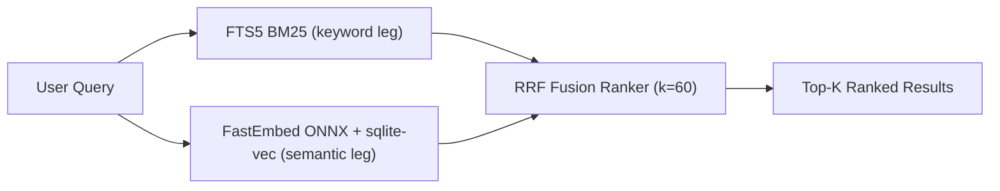

# sqlite-hybrid-search

> Production-ready hybrid search inside one standard SQLite file: FTS5 BM25 keyword search + local ONNX vector embeddings, fused with Reciprocal Rank Fusion. No servers, no cloud, no bills.

[](https://www.python.org/)
[](typescript/)
[](https://www.sqlite.org/fts5.html)
[](LICENSE)
[](https://github.com/el1zabethcodes/sqlite-hybrid-search/stargazers)
[](#why-this-exists)
[](#why-this-exists)

---

## Why this exists

Running a full vector database (Pinecone, Qdrant Cloud, Milvus) or a search cluster (Elasticsearch, OpenSearch) for a desktop app, an edge device, or a local-first product is disproportionate: heavy runtimes, monthly bills, network round-trips — for data that already lives on the user's machine.

`sqlite-hybrid-search` puts the whole retrieval stack into the database file you already have:

- **Full-text search (FTS5)** — fast BM25 lexical search with a unicode61 tokenizer (`remove_diacritics 2`), safe for multilingual input (English, Russian, Ukrainian, ...). Stored as an external-content table and kept in sync by triggers, so the index can never drift from your rows.
- **Semantic vector search** — embeddings generated locally by FastEmbed (pure ONNX runtime, no PyTorch), searched through the `sqlite-vec` extension (KNN, cosine) with an automatic pure-Python brute-force fallback when the extension is unavailable.
- **Reciprocal Rank Fusion** — a pure, dependency-free function that merges the two rankings into one score, with a configurable `k` (default 60).

Everything runs in-process. After the embedding model is cached on disk at first use, the engine is fully offline — air-gapped environments included.

## Terminal preview

```text
$ python index.py
Query: 'fast local vector search'
Vector backend: sqlite-vec

[0.03279] #2 (fts:1 vec:1): Vector databases allow high-dimensional embeddings similarity search.
[0.03226] #4 (fts:2 vec:2): FastEmbed is a lightweight and ultra-fast Python library for embeddings generation.
[0.03150] #3 (fts:4 vec:3): Reciprocal Rank Fusion fuses search rankings from multiple retrieval algorithms.
```

Document #2 wins because *both* legs rank it first: `(fts:1 vec:1)`. That is the fusion doing its job.

<!-- Animated demo placeholder — record one and uncomment:
     VHS:     https://github.com/charmbracelet/vhs   (vhs demo.tape)
     asciinema: asciinema rec demo.cast
<p align="center">
  
</p>
-->

## Pipeline



## Quickstart

```bash
git clone https://github.com/el1zabethcodes/sqlite-hybrid-search
cd sqlite-hybrid-search && pip install -r requirements.txt
python index.py
```

The first run downloads the embedding model (~30-130 MB) into the local cache; every run after that needs no network at all. Works on Windows, macOS and Linux.

## Usage — Python

```python
from sqlite_hybrid_search import HybridSearchEngine

# One SQLite file holds the rows, the FTS5 index and the vectors.
engine = HybridSearchEngine("notes.db")

engine.insert_documents([
    "SQLite WAL mode allows concurrent readers and a single writer",
    "Kubernetes pods restart automatically on OOMKill events",
])

for hit in engine.hybrid_search_rrf("wal concurrency", top_k=5, k=60):
    print(round(hit["score"], 5), hit["content"])

# Lower-level access to each leg and the pure fusion function:
engine.search_fts("wal")            # BM25-ordered ids
engine.search_vector("concurrent")  # cosine-ordered ids
from sqlite_hybrid_search import rrf

# Maintenance is explicit and trigger-synced:
engine.update_document(1, "SQLite WAL mode allows concurrent readers and writers")
engine.delete_document(2)
engine.close()
```

API: `insert_document`, `insert_documents` (batched embedding), `update_document`, `delete_document`, `search_fts`, `search_vector`, `hybrid_search_rrf` — see `SKILL.md` for the full contract.

## Usage — TypeScript (Node.js)

```bash
cd typescript && npm install && npm run demo
```

```ts
import { HybridSearchEngine } from "./hybrid_search";

const engine = new HybridSearchEngine({ dbPath: "notes.db" });
await engine.insertDocuments([
  "SQLite WAL mode allows concurrent readers and a single writer",
]);

for (const hit of await engine.hybridSearchRrf("wal concurrency", 5)) {
  console.log(hit.score.toFixed(5), hit.content);
}
engine.close();
```

The TypeScript reference (`better-sqlite3` + `sqlite-vec` + `fastembed`) mirrors the Python engine and produces identical fusion output. Note for better-sqlite3 v13+: vec0 integer parameters (primary keys, `k`) must be bound as `BigInt` — handled internally by the reference.

## How the fusion works

Each leg returns a ranked list of ids. RRF merges them by rank, not by raw score:

```text
score(d) = sum over legs of 1 / (k + rank_leg(d))        k = 60 (default)
```

Raw scores are incomparable across engines — BM25 is unbounded, cosine similarity lives in [-1, 1] — but ranks are always comparable. RRF needs no score normalization, no tuning per corpus, and rewards consensus: documents retrieved by both legs surface to the top. Each leg contributes `top_k * 3` candidates; the FTS leg matches with OR by default (recall-friendly, precision comes from BM25 ranking), with strict `AND` available via `search_fts(..., operator="AND")`.

## Comparison

| Metric | Elasticsearch / Qdrant Cloud | sqlite-hybrid-search |
|---|---|---|
| Memory footprint | 500 MB - 2 GB+ (JVM heap, cluster) | tens of MB, in-process |
| Latency | 5-50 ms plus network round-trip | sub-ms FTS5; ms-scale vector scan on laptop-scale corpora |
| Dependencies | JVM, cluster nodes, sidecars | `pip install fastembed sqlite-vec` |
| Offline support | No (cloud) / partial (self-hosted cluster) | Yes — air-gapped after model download |
| Storage engine | Proprietary formats, cluster state | one standard `.db` file — copyable, backupable, diffable |
| Cost | monthly bills or ops headcount | $0 |
| Ops burden | upgrades, heap tuning, TLS, users | none — it is a library, not a service |

### When to graduate to a real search engine

This library is the right tool up to roughly a million documents on a single machine with a single writer. Reach for Qdrant/Elasticsearch/OpenSearch when you need: p99 latency SLOs over multi-million-doc corpora, many concurrent writers, shared multi-tenant indexes, or distributed replication. Your schema maps over cleanly — embeddings and RRF transfer as-is.

## Project layout

| Path | What it is |
|---|---|
| `sqlite_hybrid_search.py` | Python reference engine: `HybridSearchEngine`, pure `rrf()` function |
| `index.py` | Runnable Python demo (`python index.py`) |
| `tests/` | Offline unit tests covering both vector backends |
| `typescript/` | TypeScript reference implementation (better-sqlite3 + sqlite-vec + fastembed) |
| `SKILL.md` | Agent skill spec: activation triggers, DDL and function contracts, rules, pitfalls |
| `requirements.txt` | Python dependencies |

## Using with AI agents

`SKILL.md` is a self-contained spec for coding agents (Claude Code, Cursor, Windsurf, Roo Code): it tells the agent when to reach for this pattern, gives the exact DDL and function contracts, and lists the rules that keep FTS5 external-content indexes and vec0 tables correct. Point your agent at it and ask for "local hybrid search" — the reference implementations here are the ground truth it should match.

## Roadmap

- [x] FTS5 BM25 keyword leg (external-content table, trigger-synced, OR/AND operators)
- [x] Vector leg via FastEmbed ONNX embeddings (no PyTorch, no transformers)
- [x] sqlite-vec KNN backend with pure-Python brute-force fallback
- [x] Reciprocal Rank Fusion with configurable k (default 60)
- [x] Offline-capable: no network calls after the model is cached
- [x] TypeScript / Node.js reference implementation (better-sqlite3 + sqlite-vec)
- [ ] Auto-migration CLI that adds FTS/vector indexes to an existing SQLite schema
- [ ] Optional reranking stage (cross-encoder)
- [ ] Chunking helpers for long documents
- [ ] Publish to PyPI and npm
- [ ] Browser/WASM build (sql.js + sqlite-vec wasm)

## License

MIT — see [LICENSE](LICENSE).
